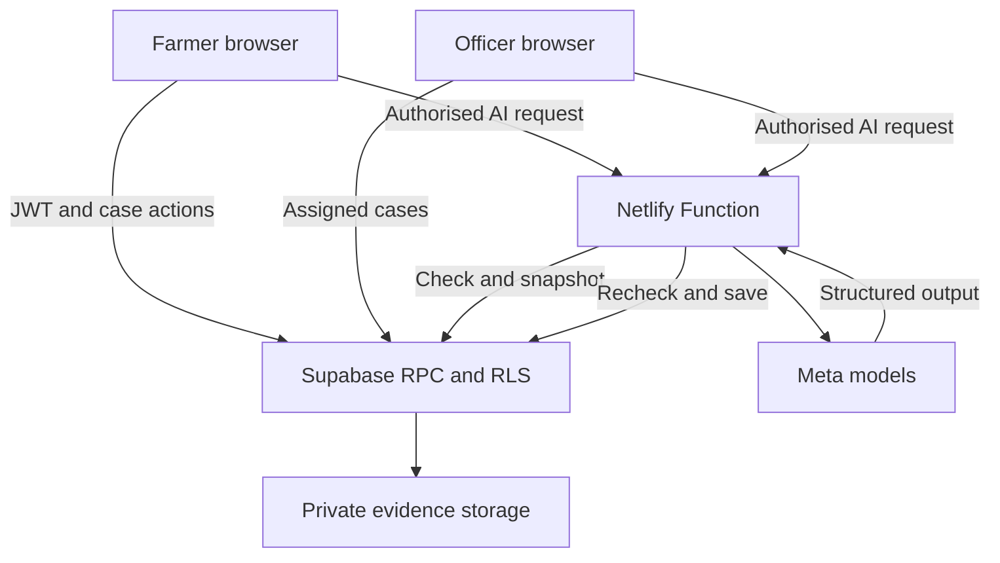

# Architecture

React on Netlify talks to Supabase Auth, PostgreSQL RPCs, private Storage and Realtime. Meta requests go through a Netlify Function. No Railway service or MongoDB instance is required.

| Layer                 | Responsibility                                                                                |
| --------------------- | --------------------------------------------------------------------------------------------- |
| React and vanilla CSS | Dashboards, voice capture, image resizing, local drafts and playback                          |
| Supabase Auth         | Email verification, passwords, token refresh and authenticator factors                        |
| PostgreSQL            | Authoritative roles, assignments, sessions checks, reports, messages, notifications and audit |
| Supabase Storage      | Private bounded photo and audio objects                                                       |
| Supabase Realtime     | RLS-filtered change events that trigger fresh queries                                         |
| Netlify Meta Function | Paid model requests and server-authorized result persistence                                  |

## Access model

Farmers read their own reports. Officers read assigned reports. Administrators read all records only after an actual MFA challenge. Users who have enrolled MFA also need `aal2` for data access. Profiles are authoritative; user-editable auth metadata never controls roles.

RLS denies direct mutations to public application tables. The exposed `farmrelay_api` function validates the caller and performs allowed mutations in one PostgreSQL transaction. This keeps the primary change, notification and audit entry consistent. Unique UUIDs prevent duplicate reports/messages. Version checks prevent stale reviewer writes.

The database checks the JWT `session_id` against `auth.sessions` and the user's revocation cutoff. Suspension, demotion and explicit revocation affect already issued access tokens at the data layer. Signed Storage URLs remain bearer capabilities until expiry; they cannot be made unreadable after someone has downloaded their content.

## AI pipeline

The Netlify Function passes the caller's bearer token to a rate-limited database authorization RPC. It downloads private evidence with that caller's permissions, sends the input to Meta and uses a server-only secret to save the result. The save RPC rechecks the actor, session, access version and assignment. Clients cannot write AI results through tables or the service-only save function.

Transcription converts the original recording into mono 16 kHz PCM WAV in the browser. The server validates WAV format and size. An authorized reviewer supplies the conversion, so it is not a cryptographic proof of equivalence to the original. Keep the original available for comparison. Only English transcription is enabled; other language recordings need human review.

## Connectivity and storage

Images are resized to 1200 pixels maximum dimension. Audio is short and bounded. Drafts are written to per-account IndexedDB before submission. The storage upload and database insert are separate services; best-effort cleanup removes failed unreferenced uploads, while a restrictive policy protects committed attachments. Periodic orphan cleanup remains an operator task.

Signed photo/audio links last five minutes. Opening or refreshing a report obtains new links. Refreshing before transcription obtains a fresh recording link. Auth sessions use the Supabase browser SDK, including browser storage, rather than HttpOnly custom cookies. Avoid shared browser profiles for sensitive drafts and recordings.

Realtime events refresh lists and conversations. Report details preserve unsaved review edits and show a refresh notice instead of replacing them. Realtime is an enhancement; stored records remain authoritative.

## Investigation data model

| Record          | Purpose                                                                                                       |
| --------------- | ------------------------------------------------------------------------------------------------------------- |
| `reports`       | Owner, assignment, optimistic version, evidence version, answers, status, follow-up date and reported outcome |
| `case_evidence` | Private object metadata, photo label/language and stable client request ID                                    |
| `case_events`   | Human timeline, answers, evidence additions and status changes                                                |
| `ai_runs`       | Kind, state, evidence version, actor/session access context and validated output                              |

`farmrelay_investigation` returns scoped snapshots and performs idempotent case actions. `farmrelay_start_analysis` locks the case, checks role/crop, deduplicates paid starts and creates a processing run. `farmrelay_finish_analysis` is service-only and rejects changed access, sessions, assignments or evidence. New evidence marks the output superseded rather than letting it replace current observations.

Complete output is cached per kind and evidence version. To incorporate an automatic transcript into an existing cached brief, the officer must save a reviewed transcript correction/translation first; that creates a new evidence version. Unreviewed transcripts are identified as such and never substitute for the original audio.

The structured brief separates farmer-reported observations, visible observations, tentative possibilities and unknowns. Citation validation verifies source IDs, not the truth of model prose. Visible observations must cite supplied photographs. Only up to three recent photos are sent per call. Reference records are background metadata, not a retrieved treatment knowledge base.

## Submission recovery

A stable client ID creates the case once. Each uploaded object and action request ID is checkpointed in IndexedDB. On failure, Device drafts retries the saved submission without editing its already-created cloud fields. A partial case can appear before its evidence is committed. Additional attachments use the same checkpoint approach. Orphan objects require operator cleanup; no automatic background retry is claimed.

The service worker caches the application shell only. It does not persist authorised API responses or private media. Guided questions during capture use a deterministic offline checklist. Model-generated questions are requested after successful submission.
